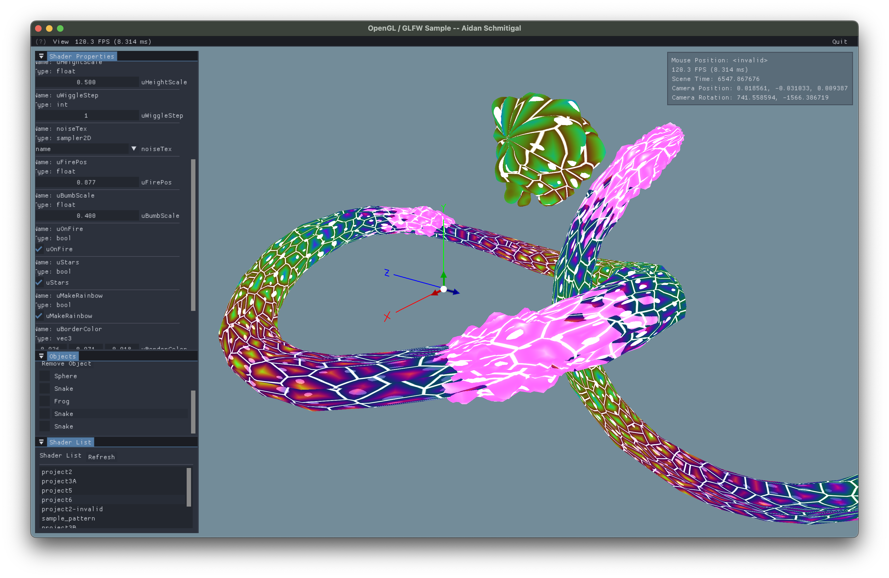
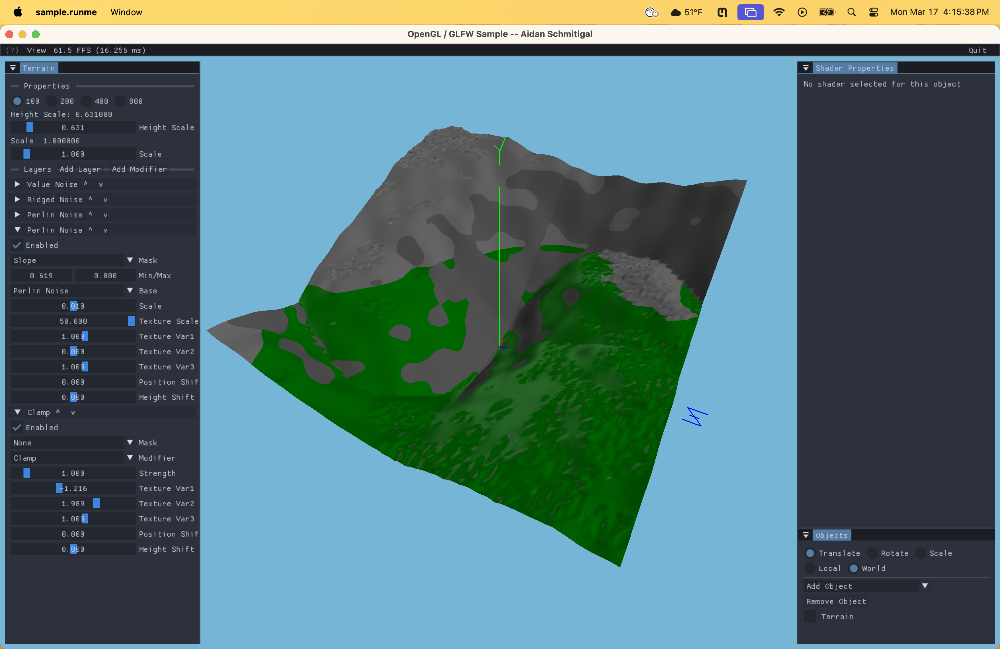
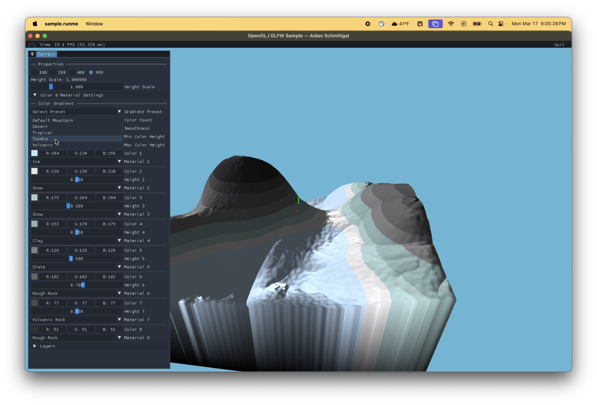
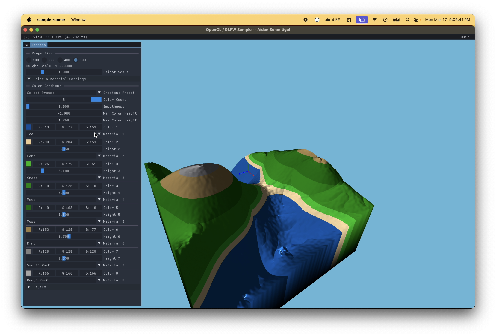
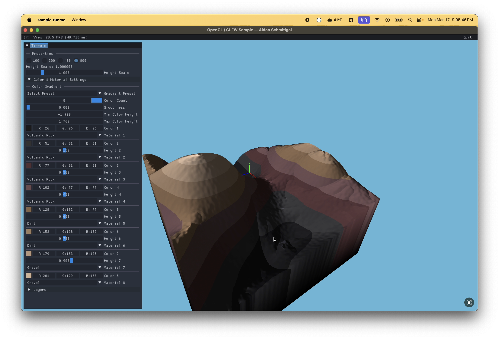

# CS557 - Computer Graphics Shaders

Selected projects from my computer graphics shaders class. [View the full collection and project descriptions](../README.md).

## [Project 6 - Shader Snake](Project6/)

## [Final Project - Shader Terrain Editor](FinalProject/)

| Mountain landscape                                                                  | Layered terrain materials                                              |
| ----------------------------------------------------------------------------------- | ---------------------------------------------------------------------- |
|  |  |
| **River valley**                                                                    | **Earth-toned terrain**                                                |
|                            |         |
