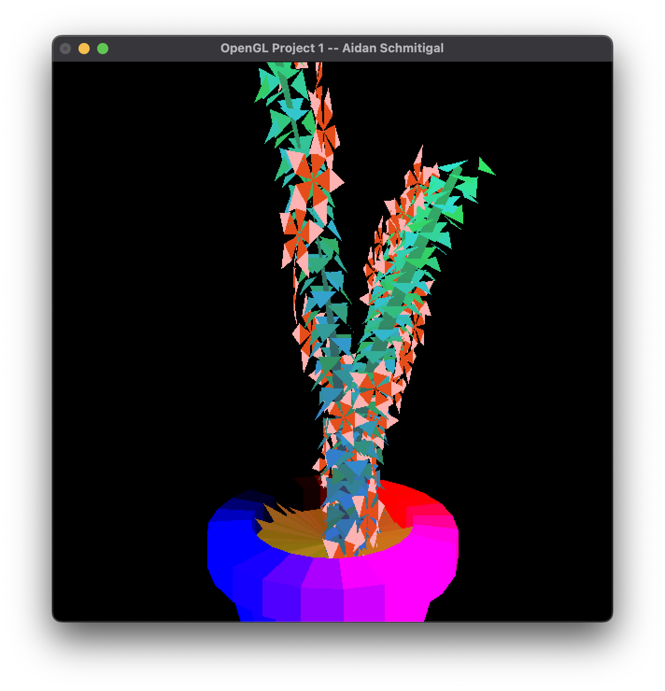
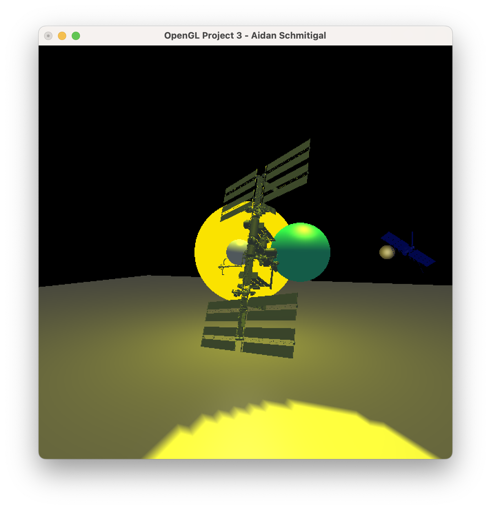
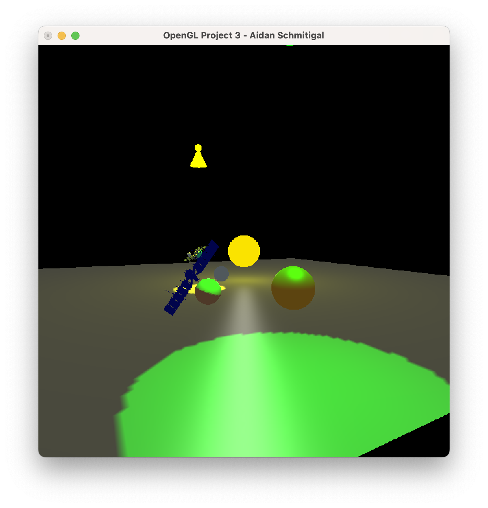
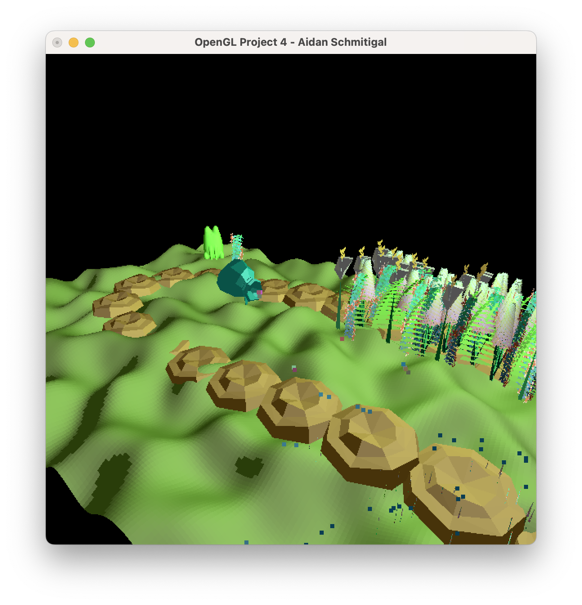
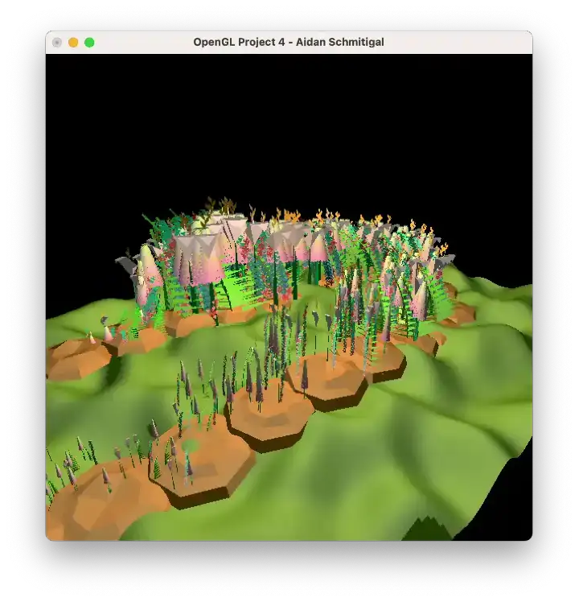
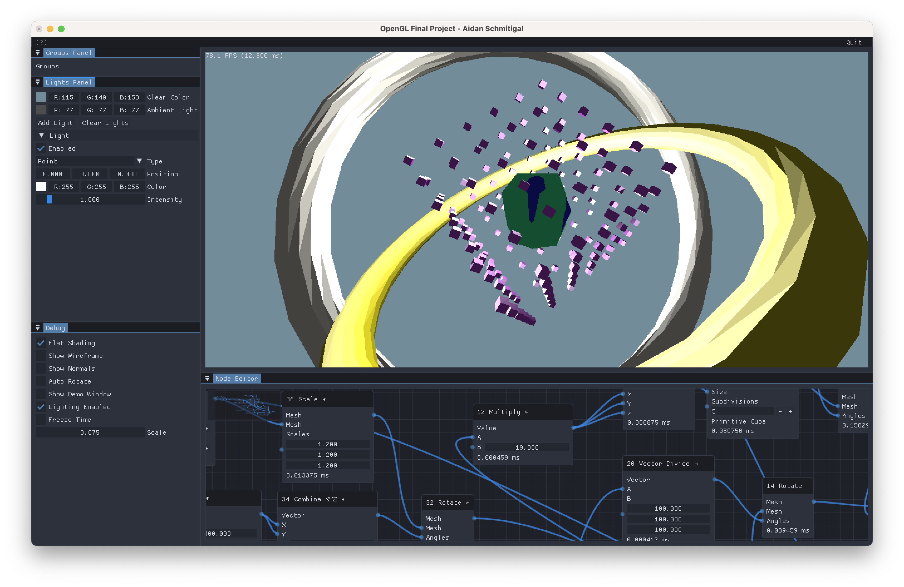
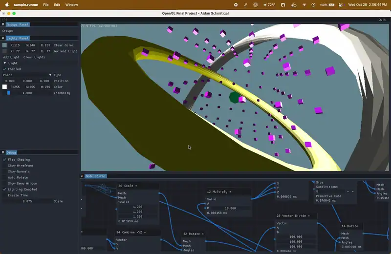

# Computer Graphics Coursework

A collection of my favorite projects from **CS550 - Computer Graphics** and **CS557 - Computer Graphics Shaders** at Oregon State University. These are the ones I had the most fun with and did a little extra.

From the courses: [CS550](CS550/) & [CS557](CS557/).

## Assignments

| Course | Project                                                      | What I did                                                                                                                                                                                                                                                              |
| ------ | ------------------------------------------------------------ | ----------------------------------------------------------------------------------------------------------------------------------------------------------------------------------------------------------------------------------------------------------------------- |
| CS550  | [Project 1 - Procedural Plant](CS550/Project1/)              | Made a plant entirely from procedural geometry, with a colorful pot, a twisting stem, golden-ratio leaf placement, and flowers oriented to the stem's surface.                                                                                                          |
| CS550  | [Project 3 - Lighting a Scene](CS550/Project3/)              | Miniature orbital scene with planets, moons, the ISS, and Europa Clipper, using hierarchical transformations, elliptical orbits, and lights that follow the bodies.                                                                                                     |
| CS550  | [Project 4 - Keytime Garden](CS550/Project4/)                | Noise-based grass, models I made in Blender, a watering can and seed pouch moving along equation defined paths, water and seed particles, growing flowers, and a bouncing frog with squash and stretch. The camera and colored light are animated too.                  |
| CS550  | [Final Project - Geometry Nodes](CS550/FinalProject/)        | Built a Blender-inspired procedural node editor with geometry primitives, vector and scalar math, transformations, instancing, scene time, graph saving/loading, lighting controls, and a debug renderer.                                                               |
| CS557  | [Project 6 - Shader Snake](CS557/Project6/)                  | Combined animated Voronoi-based coloring and displacement, rainbow scales, noise-based spots, a bending and waving body, and a fire effect along the snake.                                                                                                             |
| CS557  | [Final Project - Shader Terrain Editor](CS557/FinalProject/) | Made an interactive editor with eight layers of shader-generated noise, height and slope masks, an eight-color material gradient, lighting, material presets, and selectable grid resolutions. Changing the layers and materials makes completely different landscapes. |

## CS550 - Computer Graphics

### [Project 1 - Procedural Plant](CS550/Project1/)

### [Project 3 - Lighting a Scene](CS550/Project3/)

| Orbital scene and ISS                                                    | Europa Clipper and colored lighting                                                          |
| ------------------------------------------------------------------------ | -------------------------------------------------------------------------------------------- |
|  |  |

### [Project 4 - Keytime Garden](CS550/Project4/)

### [Final Project - Geometry Nodes](CS550/FinalProject/)

## CS557 - Computer Graphics Shaders

### [Project 6 - Shader Snake](CS557/Project6/)

### [Final Project - Shader Terrain Editor](CS557/FinalProject/)

| Mountain landscape                                                                         | Layered terrain materials                                                                           |
| ------------------------------------------------------------------------------------------ | --------------------------------------------------------------------------------------------------- |
|  |  |
| **River valley**                                                                           | **Earth-toned terrain**                                                                             |
|    |         |

## Building and running

All six projects are written in C++ and include a `Makefile`. From a project's folder, build with `make` and run `./sample.runme`. The supplied Makefiles target macOS and OpenGL; depending on the project and your setup, you may need to download or configure dependencies such as Dear ImGui, GLM, or GLFW, and adjust the Makefile's include and library paths.
